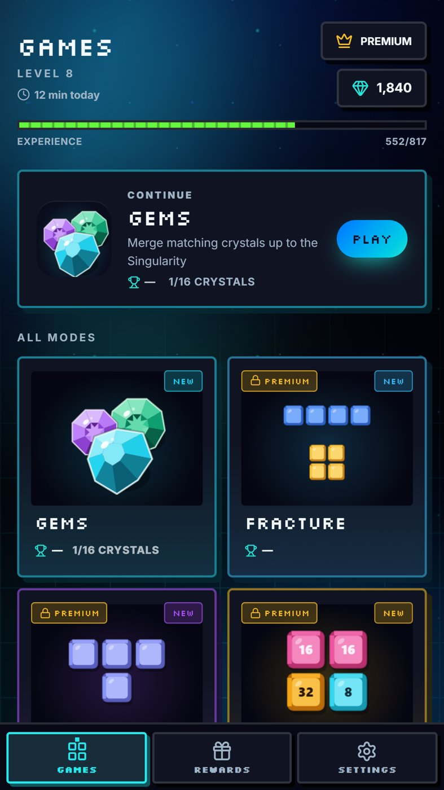
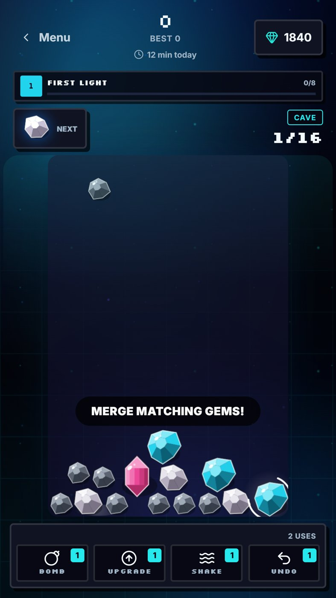
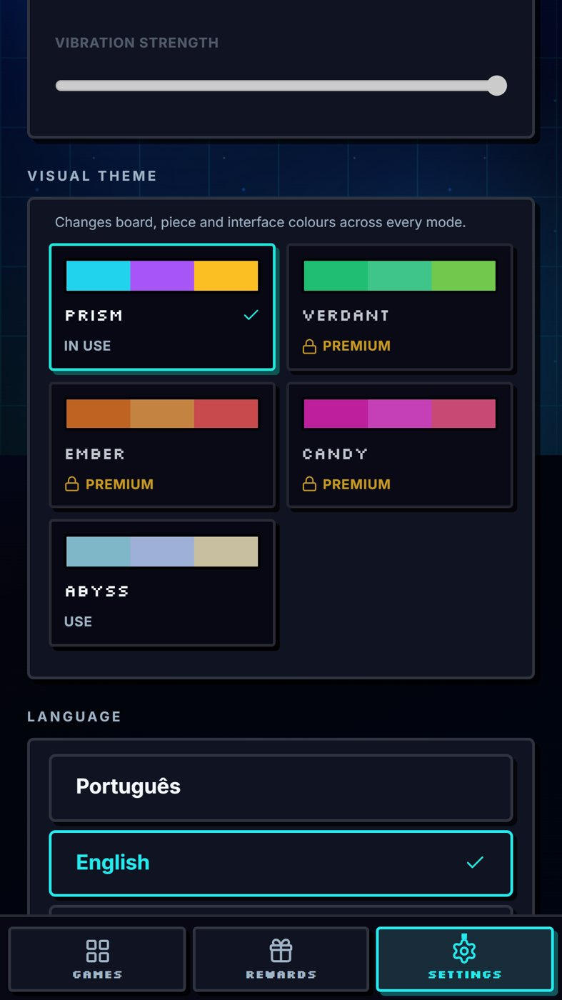

# Facet

Six puzzle games, one progression. Every game feeds the same level and crystal collection, so short sessions in any mode move you forward.

**[facett.app](https://facett.app)** · iOS, Android and the web

## What it does

- Six modes, including Gems, Fusion, Fracture and Mosaic
- Shared level, experience and crystals across all games
- Visual themes and several languages

## Built with

TypeScript, React, TanStack Start, Supabase, Capacitor, AdMob, StoreKit, Google Play Billing.

The source code is private. This repository only holds the presentation.

---
A product of [Depozza SAS](https://depozza.com).
